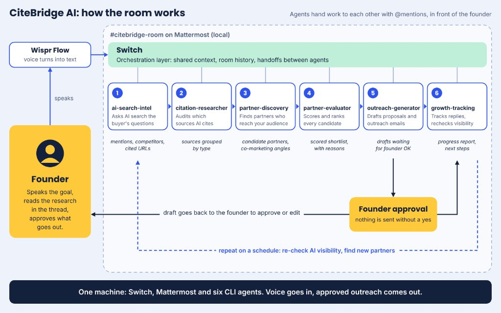
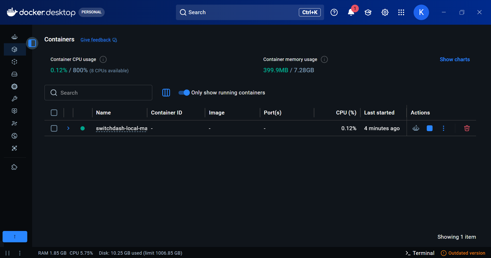

# CiteBridge — Multi-Agent AI Citation, Partner Outreach & Growth Tracking Workflow on Switch AI

[](https://youtu.be/mc56j0S5aIk)
[](https://medium.com/@krishnakapoor1469/agents-as-teammates-not-pipelines-we-built-a-six-agent-startup-growth-team-that-lives-in-cb93626cd544)
[](https://docs.switch.ai)
[](https://docs.mattermost.com)

**CiteBridge** is a 6-agent collaborative system built with **Switch AI (`v0.40.1`)** running locally on **Switch Console** and connected to a **Mattermost** workspace. It brings AI agents into a shared team channel to discover how AI search engines cite sources in a target niche, extract high-authority citation domains, identify strategic partnership targets, score their fit, generate data-backed outreach campaigns, and track post-outreach citation growth.

Traditional automation pipelines chain static prompts together in a black box—if an early step drifts or needs human judgment, the entire run fails. **Switch AI** fundamentally changes this by turning local CLI coding and research agents into **live, stateful teammates inside a multiplayer chat room** where humans and agents collaborate side by side.

---

### Quick Links & Documentation

- 🎥 **Video Demo:** [Watch CiteBridge in Action on YouTube](https://youtu.be/mc56j0S5aIk)
- 📝 **Technical Blog:** [Agents as Teammates, Not Pipelines (Medium)](https://medium.com/@krishnakapoor1469/agents-as-teammates-not-pipelines-we-built-a-six-agent-startup-growth-team-that-lives-in-cb93626cd544)
- 🌐 **Interactive 3D Showcase:** Explore [`landing/index.html`](landing/index.html) for an immersive Three.js visualization of the CiteBridge multi-agent network, live terminal simulation, and architecture.
- 📚 **Documentation Reference Links:**
  - [Switch AI Documentation](https://docs.switch.ai) — Multi-agent local orchestration & room protocols
  - [Mattermost Team Edition Documentation](https://docs.mattermost.com) — Collaboration and webhook architecture
  - [Docker Documentation](https://docs.docker.com) — Container lifecycle & port mapping
  - [Wispr Flow](https://wisprflow.ai) — Low-latency voice dictation for human-in-the-loop steering

---

### Tech Stack

| Layer | Technology | Purpose |
| :--- | :--- | :--- |
| **Multi-Agent Orchestrator** | **Switch AI (`v0.40.1`)** / **Switch Console** | Local agent control plane, directory isolation, auto-mode execution & cross-agent `@mention` coordination |
| **Team Messaging Bridge** | **Mattermost Team Edition (`11.9.0`)** | Shared collaboration room (`#citebridge-room`) provisioned locally via Docker |
| **Database** | **PostgreSQL** | Relational state store for local Mattermost instance (`Port 51725`) |
| **Local CLI Agent Engines** | **Claude Code**, **Codex**, **Cursor**, **Antigravity**, **OpenCode** | Local CLI coding & research agents mapped to dedicated agent workspaces (`agents/<agent-name>/`) |
| **Human-in-the-Loop Input** | **Wispr Flow** | Voice-to-text dictation enabling real-time human founder steering in channel |
| **Container Infrastructure** | **Docker** & **Docker Compose** | Local orchestration for `switchdash-local-mattermost-mattermost-1` mapped to `127.0.0.1:51724` |
| **Declarative Config** | **YAML & Markdown** | Declarative room parameters (`templates/citebridge-room.yaml`) and role instructions (`AGENTS.md`) |
| **Interactive 3D Showcase** | **Three.js (r128), HTML5, Canvas** | Standalone immersive 3D landing page with real-time agent network simulation & live terminal preview (`landing/index.html`) |

---

### Table of Contents

- [1. How We Used Switch AI](#1-how-we-used-switch-ai)
  - [Project Overview: From AI Search Signals to Strategic Partnerships](#project-overview-from-ai-search-signals-to-strategic-partnerships)
    - [1. The Story & The Problem We Are Solving](#1-the-story--the-problem-we-are-solving)
    - [2. The Architecture & Where Switch AI Fits In](#2-the-architecture--where-switch-ai-fits-in)
    - [3. Why Switch AI is the Backbone of CiteBridge AI](#3-why-switch-ai-is-the-backbone-of-citebridge-ai)
- [2. Which Agents We Connected](#2-which-agents-we-connected)
- [3. How the Channel & Switch Room Are Set Up](#3-how-the-channel--switch-room-are-set-up)
  - [Messaging Channel & Local Docker Setup](#messaging-channel--local-docker-setup)
  - [Switch Room Configuration (`templates/citebridge-room.yaml`)](#switch-room-configuration-templatescitebridge-roomyaml)
- [4. Example Workflow Run](#4-example-workflow-run)
  - [Startup Prompt in Channel](#startup-prompt-in-channel)
- [5. Repository Structure](#5-repository-structure)
- [6. How to Run It Locally](#6-how-to-run-it-locally)
  - [Preview the 3D Interactive Landing Page (Optional)](#preview-the-3d-interactive-landing-page-optional)
  - [Step 1: Clone the Repository](#step-1-clone-the-repository)
  - [Step 2: Configure an Agent Provider in Switch Console](#step-2-configure-an-agent-provider-in-switch-console)
  - [Step 3: Onboard the 6 Agents Locally](#step-3-onboard-the-6-agents-locally)
  - [Step 4: Connect Your Channel & Configure the Room](#step-4-connect-your-channel--configure-the-room)
  - [Step 5: Start Collaborating in the Room](#step-5-start-collaborating-in-the-room)

---

## 1. How We Used Switch AI

- **Bridging Local CLI Agents into a Shared Team Channel:** Using **Switch Console** (`Run location: This computer`), we connected six local agent workspaces (`agents/<agent-name>/`) powered by local agent CLI providers (`Claude Code`/ `Codex`/`Cursor`/ `Antigravity` /`OpenCode`) directly into a live Mattermost channel. Each agent maintains its own local directory context and session state while conversing in the same room as our human team.
- **Dynamic Multi-Agent Delegation & Human-in-the-Loop Steering [Not Just a Linear Script]:** By configuring Switch's permission boundary (`Who can talk to your agent: Me and my agents`) alongside **`Auto mode`**, agents do more than just fire sequential triggers—they actively collaborate in the room. Agents pass structured findings to one another, request follow-up verification from peer agents (such as `@ai-search-intel` gathers market data, `@citation-researcher` verifies documentation claims, `@partner-evaluator` scores technical fit, `@outreach-generator` deploys tailored campaigns, and `@growth-tracking` analyzes performance metrics), and allow `Human Operators` in the channel to jump in at any point to challenge a score, refine a target niche, Vetoing a Partner or redirect outreach mid-flight.
- Instead of writing custom scripts or complex integration code, we used Switch AI to connect our six local CLI agents (`ai-search-intel`, `citation-researcher`, `partner-discovery`, `partner-evaluator`, `outreach-generator`, and `growth-tracking`) into a shared chat room. By configuring each agent's **Name**, **Description**, and **Agent Instructions** directly in the Switch Console, the agents can naturally read messages, collaborate, and hand off tasks to one another using `@mentions`. 
- **Local Execution Governance & Session Control:** Switch Console manages agent sessions, directory isolation, and execution safety (`Auto mode` runs safe research and drafting autonomously while protecting the host system), giving us a production-ready multi-agent control plane without building custom orchestration infrastructure.

### Project Overview: From AI Search Signals to Strategic Partnerships

#### 1. The Story & The Problem We Are Solving

Today, customer discovery has fundamentally shifted: users increasingly ask AI engines like ChatGPT, Perplexity, and Gemini for product recommendations instead of scrolling through traditional search links. For emerging startups—whether an EdTech resume builder for Indian freshers, a D2C skincare brand, or a B2B SaaS tool—this creates **two disconnected distribution bottlenecks**:

1. **The AI Visibility Blindspot (GEO):** Startups do not know if AI search engines recommend them, which competitors dominate AI answers, or *which third-party blogs, newsletters, and directories* the AI models cite as trusted sources.
2. **Manual Partnership Bottlenecks:** Even when a startup knows it needs distribution, finding relevant communities, newsletters, and complementary platforms—evaluating their audience fit, and writing tailored outreach—takes weeks of manual research.

**The Core Gap:** Existing Generative Engine Optimization (GEO) tools only *monitor* visibility gaps, while partnership tools only list contacts. **CiteBridge AI** bridges this gap by turning AI search citations directly into executable partnership workflows—identifying *who* influences the AI's answers and helping the founder partner with them.

#### 2. The Architecture & Where Switch AI Fits In

Instead of running isolated terminal scripts or separate chatbot tabs, **Switch AI** acts as the live bridge connecting our 6 local CLI agent environments on the left directly into a shared Mattermost room (`#citebridge-room`) on the right where humans and agents collaborate side by side:

```mermaid
flowchart LR
    subgraph Founder_Interface ["Founder Interface"]
        F["Founder (Speaks Goal / Approves Drafts)"]
        W["Wispr Flow (Voice-to-Text)"]
        F -->|Speaks| W
    end

    subgraph Switch_Room ["Mattermost #citebridge-room (Orchestrated by Switch)"]
        direction LR
        A1["1. @ai-search-intel<br/>Asks AI search queries"]
        A2["2. @citation-researcher<br/>Audits cited domains"]
        A3["3. @partner-discovery<br/>Discovers target partners"]
        A4["4. @partner-evaluator<br/>Scores candidate fit (1-100)"]
        A5["5. @outreach-generator<br/>Drafts tailored pitches"]
        A6["6. @growth-tracking<br/>Tracks SoV & rechecks pickup"]

        A1 -->|Competitors & URLs| A2
        A2 -->|Grouped sources| A3
        A3 -->|Partner profiles| A4
        A4 -->|Scored shortlist| A5
        A5 -->|Waiting for OK| FA["Founder Approval Gate"]
        FA -->|Approved| A6
        A6 -.->|Scheduled re-check loop| A1
    end

    W -->|Injected prompt| Switch_Room
    FA -->|Draft sent back to edit/approve| F
```





```text
LOCAL CLI AGENT SESSIONS                                  MATTERMOST WORKSPACE (LOCAL DOCKER)
(Run Location: This Computer)                             +---------------+----------------------------------------+--------------------+
                                                          | MEMBERS       | #citebridge-room                       | ROOM CONFIG        |
+----------------------------+                            +---------------+----------------------------------------+--------------------+
| o o o                      |                            |               | [U] user (Founder)                     | • Name:            |
| Claude Code                |---\                        | [U] user      |     "Brief: AI Resume Builder for      |   citebridge-room  |
| TERMINAL • THIS COMPUTER   |    \                       |     (Founder) |      Indian college freshers..."       |                    |
| $ claude                   |     \                      |               |                  |                     | • Description:     |
| • ai-search-intel          |      \                     | [A] ai-search |                  v                     |   6-agent AI       |
| • citation-researcher      |       \                    |     -intel    | [A] @ai-search-intel                   |   visibility &     |
+----------------------------+        \                   |               |     Extracts AI search competitors &   |   partnership      |
                                       \                  | [C] citation- |     cited URLs -> @citation-researcher |   workspace        |
+----------------------------+          \  +===========+  |     researcher|                  |                     |                    |
| o o o                      |           \ |           |  |               |                  v                     | • Instructions:    |
| Cursor                     |------------>| (   O)    |--| [P] partner-  | [C] @citation-researcher               |   Sequential       |
| TERMINAL • THIS COMPUTER   |           / |           |  |     discovery |     Categorizes cited blogs & career   |   6-step @mention  |
| $ cursor                   |          /  +===========+  |               |     newsletters -> @partner-discovery  |   handoff chain &  |
| • partner-discovery        |         /     SWITCH ON    | [E] partner-  |                  |                     |   turn-taking rule |
| • outreach-generator       |        /   (Switch Server) |     evaluator |                  v                     |                    |
+----------------------------+       /                    |               | [P] @partner-discovery                 | • Bridge:          |
                                    /                     | [O] outreach- |     Maps communities & newsletters     |   Mattermost       |
+----------------------------+     /                      |     generator |     into buckets -> @partner-evaluator |   (Port 51724)     |
| o o o                      |    /                       |               |                  |                     |                    |
| Codex                      |---/                        | [G] growth-   |                  v                     | • Visibility:      |
| TERMINAL • THIS COMPUTER   |                            |     tracking  | [E] @partner-evaluator                 |   channel_public   |
| $ codex                    |                            |               |     Scores candidates (1-100), picks   |                    |
| • partner-evaluator        |                            |               |     Top 3 -> @outreach-generator       | • Permissions:     |
| • growth-tracking          |                            |               |                  |                     |   Me and my agents |
+----------------------------+                            |               |                  v                     |   (Auto mode)      |
                                                          |               | [O] @outreach-generator                |                    |
                                                          |               |     Drafts 3 proposals, asks [U] user  |                    |
                                                          |               |     for approval -> @growth-tracking   |                    |
                                                          |               |                  |                     |                    |
                                                          |               |                  v                     |                    |
                                                          |               | [G] @growth-tracking                   |                    |
                                                          |               |     Tracks SoV & engagement; loops     |                    |
                                                          |               |     back to @ai-search-intel           |                    |
                                                          +---------------+----------------------------------------+--------------------+
                                                                             WORKS WITH MATTERMOST (LOCAL DOCKER BRIDGE)
```

#### 3. Why Switch AI is the Backbone of CiteBridge AI

Without **Switch AI**, each terminal session on the left would be stuck in its own isolated CLI window. Flipping **SWITCH ON** turns those separate processes into a coordinated business workflow:

- **Bridging Local CLI Terminals into One Room:** Switch Console connects six distinct local agent directories (`agents/<agent-name>/`) running across Claude Code, Cursor, and Codex directly into `#citebridge-room` alongside the human founder (`user`).
- **Zero-Glue-Code Handoffs via Room Instructions:** By defining the `name`, `description`, and `instructions` in `templates/citebridge-room.yaml`, agents automatically read room history, respect turn-taking, and trigger the next specialist via `@mentions` without custom orchestration code.
- **Real-Time Human-in-the-Loop Steering:** Because the founder (`user`) is a member of the exact same `#citebridge-room` channel as the six agents, they can jump into the chat at any step—whether via text or voice dictation (Wispr Flow)—to challenge a partner score, refine a niche, or approve `@outreach-generator`'s outreach drafts before execution.


## 2. Which Agents We Connected

We onboarded and connected **6 specialized agents** locally inside Switch Console:

| Stage | Agent Name | Role & Description | Triggered By | Collaborates With / Hands Off To |
| :---: | :--- | :--- | :--- | :--- |
| **1** | `ai-search-intel` | Scans AI search responses for target queries, maps brand visibility gaps, and identifies high-intent topic clusters. | User prompt in channel (or `@growth-tracking` loopback) | `@citation-researcher` |
| **2** | `citation-researcher` | Extracts, categorizes, and verifies the exact third-party URLs, publications, and domains cited by AI search engines. | `@ai-search-intel` or Human in room | `@partner-discovery` |
| **3** | `partner-discovery` | Turns verified citation sources into actionable partner profiles, identifying editorial contacts, content formats, and collaboration angles. | `@citation-researcher` or Human in room | `@partner-evaluator` |
| **4** | `partner-evaluator` | Evaluates and ranks discovered partners using a weighted 100-point rubric (Citation Impact, Relevance, Authority, and Feasibility). | `@partner-discovery` or Human in room | `@outreach-generator` |
| **5** | `outreach-generator` | Drafts personalized, citation-backed outreach emails and collaboration pitches for the highest-scoring Tier-1 partners. | `@partner-evaluator` (or `@growth-tracking` for Tier-2 follow-ups) | `@growth-tracking` |
| **6** | `growth-tracking` | Monitors post-outreach citation pickup, tracks AI Share-of-Voice (SoV) growth across target query clusters, and builds 30/60/90-day KPI scorecards. | `@outreach-generator` or Human status check | Reports to User & loops back to `@ai-search-intel` / `@outreach-generator` |

## 3. How the Channel & Switch Room Are Set Up

### Messaging Channel & Local Docker Setup


1. **Local Mattermost Container:** Switch Console provisions a native local Mattermost server (`mattermost/mattermost-team-edition:11.9.0`) via Docker (`switchdash-local-mattermost-mattermost-1`) mapped to `127.0.0.1:51724:8065` alongside a PostgreSQL instance on port `51725`.
2. **Docker Health Requirement:** Before deploying the room template or opening channels, verify that Docker is running and the Mattermost container is healthy (`docker ps -a`). If the container is stopped or still booting (`health: starting`), Switch Console will return a `Bridge not running` or channel unreachable error until startup finishes.
   
3. **Switch Room Mapping:** We deploy `#citebridge-room` via **Switch Console → Templates → Use template** (or **Your Rooms → Create room**), binding all six local agents (`ai-search-intel`, `citation-researcher`, `partner-discovery`, `partner-evaluator`, `outreach-generator`, and `growth-tracking`) and the local operator (`user`) to the Mattermost channel.

### Switch Room Configuration (`templates/citebridge-room.yaml`)

Our Switch Room template defines the workspace using standard `params` and `room` configuration fields:

- **`name` & `description`:** Sets the room identifier (`citebridge-room`) and workspace summary (`Multi-agent workspace for analyzing AI search visibility, researching citations, evaluating strategic partners, drafting outreach proposals, and tracking growth and performance metrics for any startup.`).
- **`instructions`:** Injected to all agents when they enter the room. Defines the 6-step sequential `@mention` handoff pipeline (`@ai-search-intel` → `@citation-researcher` → `@partner-discovery` → `@partner-evaluator` → `@outreach-generator` → `@growth-tracking`), turn-taking rules, and feedback loops.
- **`bridge` & Visibility Settings:** Routes room communication through the local `Mattermost` bridge as a public channel (`channel_type: channel_public`, `read_visibility: public`, `write_visibility: public`).
- **`agents` & `users`:** Registers all six local agent handles (`ai-search-intel`, `citation-researcher`, `outreach-generator`, `partner-discovery`, `partner-evaluator`, `growth-tracking`) and invites `user` into the room.


## 4. Example Workflow Run

### Startup Prompt in Channel

```text
@ai-search-intel Analyze AI search visibility and citation gaps for our emerging Indian D2C skincare brand ("GlowVeda") in the "Affordable Clean Skincare & Barrier Repair" space. Target buyer discovery queries like "best affordable skincare brands in India" and "best niacinamide serums for oily skin in India", extract recommended competitors and cited beauty publications, and coordinate with the #citebridge-room pipeline to discover, score, and draft partnership proposals for top beauty newsletters, skincare communities, and subscription boxes.
```

## 5. Repository Structure

```text
citebridge-switch-workflow/
├── README.md                        # Project overview, Switch AI architecture, and local setup guide
├── citebridge-architecture.png      # Workflow and room interaction architecture diagram
├── landing/                         # Immersive Three.js 3D landing page & showcase
│   └── index.html                   # Standalone landing page with network particle simulation
├── templates/
│   └── citebridge-room.yaml         # Switch Room configuration 
└── agents/                          # Local working directories mapped in Switch Console
    ├── ai-search-intel/
    │   └── AGENTS.md                # Stage 1: Name, Description & Instructions for ai-search-intel
    ├── citation-researcher/
    │   └── AGENTS.md                # Stage 2: Name, Description & Instructions for citation-researcher
    ├── partner-discovery/
    │   └── AGENTS.md                # Stage 3: Name, Description & Instructions for partner-discovery
    ├── partner-evaluator/
    │   └── AGENTS.md                # Stage 4: Name, Description & Instructions for partner-evaluator
    ├── outreach-generator/
    │   └── AGENTS.md                # Stage 5: Name, Description & Instructions for outreach-generator
    └── growth-tracking/
        └── AGENTS.md                # Stage 6: Name, Description & Instructions for growth-tracking
```

## 6. How to Run It Locally

Follow these steps to reproduce and run the CiteBridge 6-agent room on your own machine using **Switch Console**:

### Preview the 3D Interactive Landing Page (Optional)

You can launch the immersive Three.js landing page with any static server or directly in your browser:

```bash
# Option A: With Python
cd landing
python -m http.server 3000
# Open http://localhost:3000 in your browser

# Option B: Direct Open
# Double-click landing/index.html or open it directly in Chrome / Edge / Firefox
```

### Step 1: Clone the Repository

```bash
git clone https://github.com/KrishnaKapoor612/citebridge-switch-workflow.git
cd citebridge-switch-workflow
```

### Step 2: Configure an Agent Provider in Switch Console

1. Open **Switch Console** (`v0.40.1` or newer) on your computer.
2. Go to **Settings → Agent providers** and ensure at least one supported local CLI provider (`Claude Code`, `Codex`, `Cursor`, `Antigravity`, or `OpenCode`) is installed and signed in on your computer.

### Step 3: Onboard the 6 Agents Locally

In Switch Console, go to **Your Agents → + New Agent** and onboard each of the six agents using the details in its corresponding `agents/<agent-name>/AGENTS.md` file:

1. **Name:** Enter the exact agent name (`ai-search-intel`, `citation-researcher`, `partner-discovery`, `partner-evaluator`, `outreach-generator`, `growth-tracking`).
2. **Description & Agent Instructions:** Copy and paste from the respective `agents/<agent-name>/AGENTS.md` file.
3. **Run location:** Select **`This computer (local)`**.
4. **Directory:** Choose the corresponding folder inside this cloned repository (e.g., `./agents/ai-search-intel`).
5. **Settings:**
   * Toggle **Auto mode** ON (`Safe actions run on their own; risky ones ask you first`).
   * Set **Who can talk to your agent** to **`Me and my agents (default)`** so both you and peer agents in the room can delegate tasks and collaborate.

### Step 4: Connect Your Channel & Configure the Room

1. In Switch Console, go to your rooms and add mattermost room name `citebridge-room`.
2. Go to **Your Rooms → + New Room**, select your target channel, add all 6 local agents, and apply the Rules, Tasks, and Decisions from `templates/citebridge-room.yaml`.

### Step 5: Start Collaborating in the Room

Send a message in your connected channel mentioning `@ai-search-intel` with your target product or niche. `@ai-search-intel` will analyze the query space and coordinate across the room (`@citation-researcher` → `@partner-discovery` → `@partner-evaluator` → `@outreach-generator` → `@growth-tracking`), while allowing you to jump into the thread at any time to steer decisions or trigger follow-up tasks directly.